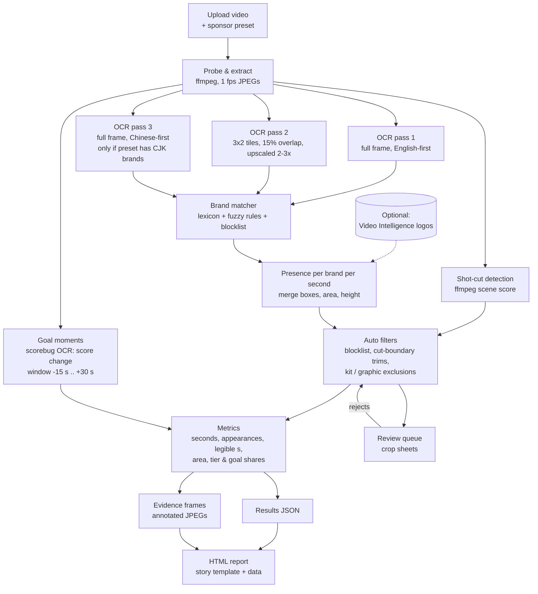
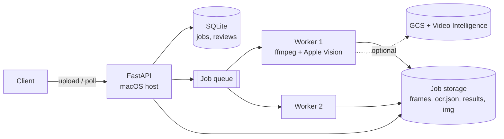

# Brand Placement Audit API: design

How to turn the `experiments/` pipeline into a service. You upload a match video and get back the same analysis the
story pages show:
- who was on the boards and for how long;
- who owned the goal moments;
- the share of each sponsor tier;
- a second-by-second timeline;
- annotated evidence frames.

The OCR engine is Apple Vision. It found 0.65–0.74 of boards on its own and was about 0.87–0.98 precise before any
review (see [BENCHMARKS.md](BENCHMARKS.md), v3). Google Video Intelligence stays optional.

---

## 1. What the user sees

1. `POST` a video, or a link to one, with a sponsor list (a tournament preset such as `wc2026`, or your own brands).
2. Poll the job. Progress is reported per stage: "OCR 312 / 600 frames".
3. When the job is done, open:
   - **the report**: the same page as `story/game-2026-final.html` (headline numbers, dumbbell chart of screen share
     against goal share, full timeline, brand table, evidence frames);
   - **the results JSON**, with the same schema as `story/game-*.json`, for your own dashboards;
   - **the review queue**: crop sheets of every detection, where a person can reject false ones. Each rejection
     updates the report.
4. Optionally, `POST` several finished jobs to `/compare` to get the overview page (tier shares across games).

Every result is labelled `review_status: "unreviewed" | "reviewed"`. In our audits, unreviewed OCR output was 87–98%
precise, but the published pages all used reviewed numbers. The API never hides that difference.

---

## 2. Pipeline view



The same pipeline as stages, with measured costs:

| # | Stage | Code it comes from | Output | Time per 10 min of video |
|---|---|---|---|---|
| 1 | Probe and extract frames at 1 fps | `common.ffmpeg_exe()`, the frame-extraction step | `frames/f_0001.jpg …` | < 1 min |
| 2 | Shot-cut detection (new) | ffmpeg `select='gt(scene,0.3)'` | list of cut times | < 1 min |
| 3 | OCR passes 1+2 (full frame and tiles) | `experiments/10_ocr.py` (`read`, `tiles`) | `ocr.json` (raw text and boxes) | **~8–10 min** (0.80–0.95 s per frame, one process, M4) |
| 4 | OCR pass 3 (Chinese) | `10_ocr.py --add-zh` | added to `ocr.json` | ~2–3 min, skipped if not needed |
| 5 | Brand matching | `common.text_matches`, `LEXICON`, `10_ocr.match` | per-second hits | seconds |
| 6 | Fusion and filters | `experiments/presence.py` | `presence.json` | seconds |
| 7 | Goal moments | `12_metrics.moments_2022` (scorebug regex), generalised | `moments` | seconds (reuses stage 3 text) |
| 8 | Metrics | `experiments/12_metrics.py`, `17_story_data.py` | `results.json` | seconds |
| 9 | Evidence frames | `experiments/19_story_images.py` | `img/*.jpg` | seconds |
| 10 | Report | `story/game-*.html`, `script.js`, `style.css` | `report.html` | instant |
| 11 | Review sheets | `experiments/15_audit_sheets.py` | crop sheets | ~10 s |

OCR is almost all of the cost. Measured end to end on an idle 10-core Mac (4 performance cores): one hour of video takes
20.7 minutes with 4 workers and 14.2 minutes with 8, and the two 10-minute highlight clips ran at 12.5 and 15.1 minutes per
video hour with 8 workers (BENCHMARKS.md v4b to v4d). An EC2 Mac host is not measured yet.

---

## 3. What has to change to go from scripts to an API

The scripts work, but several steps were done by hand for each video. Each of those needs an automatic version:

| Done by hand today | Automatic version in the API | How we know it works |
|---|---|---|
| **Precision audit**: every detection reviewed by eye, false ones in `*_rejects.csv` | (a) A **blocklist** built from the 81 audited reject rows, such as "UNITED STATES OF AMERICA" for Bank of America, "UPAMECANO" for Betano, "FIFA WORLD CUP 2026" for UPL, "AIRWAYS" for Lay's and "Powered by" for Powerade. (b) **Cut-boundary trims**: drop a detection whose box sits on a shot cut, which was the main source of false VI seconds. (c) The **review queue** for anything that matters. | Re-run on the three audited videos: automatic rejects should match most of the hand rejects, and should never remove an accepted second |
| **Goal windows**: hand-marked CSV for the 2026 games | Generalise the 2022 scorebug regex to any `AAA n n BBB` pattern (with optional flags). Detect a +1 change in the total score and use a window of −15 s to +30 s. A `PUT /moments` endpoint takes manual overrides. | Compare with the hand-marked windows for both 2026 games |
| **Kit and graphic exclusions**: `*_kit.csv` by hand | Brands marked `kit_only` in the preset (Nike, Puma), plus a box-position rule (a logo on a player and not on the boards). Anything unclear goes to the review queue. | Compare with the existing kit CSVs |
| **New sponsors**: lexicon edited per video | Presets per tournament, stored as JSON (`LEXICON`, `TIERS`, `BRAND_INFO` and the blocklist moved out of `common.py`). Users can add their own brands per job. | — |
| **Recall labels**: frames hand-labelled every 5–10 s | Not automatable; this is the benchmark. The report shows the latest OCR benchmark recall (large boards 0.76–0.92, small 0.00–0.46) as a known limit. An optional `POST /labels` scores a job the way `16_score.py` does. | — |

---

## 4. API surface

FastAPI, JSON in and out, with long-running work in background jobs.

| Method and path | Purpose |
|---|---|
| `POST /v1/jobs` | Upload a video (multipart) or `{"video_url": …}`, plus `{"preset": "wc2026", "brands": [...], "label": "2026 final · Spain v Argentina", "use_video_intelligence": false}`. Returns `{job_id}`. |
| `GET /v1/jobs/{id}` | Status, current stage, progress (`frames_done / frames_total`), errors. |
| `GET /v1/jobs/{id}/results` | The results JSON (schema below). |
| `GET /v1/jobs/{id}/report` | The HTML report: the story template with this job's JSON in it. |
| `GET /v1/jobs/{id}/evidence/{t}.jpg` | The annotated frame at second `t`. |
| `GET /v1/jobs/{id}/review` | Detections grouped into appearances, each with a crop URL. |
| `POST /v1/jobs/{id}/review` | `[{brand, start, end, verdict: "reject" \| "kit", reason}]`. Metrics are recomputed (seconds of work, no OCR). |
| `PUT /v1/jobs/{id}/moments` | Replace or add goal windows: `[{label, start, end}]`. |
| `POST /v1/jobs/{id}/labels` | Optional recall labels in the `*_gt.csv` format. Returns recall with Wilson intervals. |
| `POST /v1/compare` | `{job_ids: [...]}` → the overview page and its JSON: tier shares and Chinese-brand share across games. |
| `GET /v1/presets` | Available sponsor presets and their tiers. |

### Results schema

This is the existing `story/game-*.json`, unchanged, plus job metadata:

```json
{
  "job_id": "j_7f3a",
  "review_status": "unreviewed",
  "engine": {"ocr": "Apple Vision (full + 3x2 tiles + zh)", "video_intelligence": false},
  "label": "2026 final · Spain v Argentina", "duration": 117, "size": [1920, 1080],
  "seconds_with_any_sponsor": 68, "brand_seconds": 117,
  "moments": [{"label": "Goal 1-0", "start": 63, "end": 85, "source": "scorebug",
               "brands": [["Aramco", "Partner", 6], ["Hisense", "Sponsor", 3]]}],
  "brands": {
    "Lenovo": {"name": "Lenovo", "tier": "Partner", "country": "China",
               "visible_s": 16, "appearances": 5, "legible_s": 16, "mean_area_pct": 1.241,
               "key_moment_s": 0, "share_visible_pct": 13.7, "share_key_moment_pct": 0.0,
               "timeline": [[25, 1], [26, 1]]}
  },
  "tiers": {"Partner": {"share_visible_pct": 66.7, "share_key_moment_pct": 60.0}},
  "benchmark": {"ocr_board_recall_large": [0.76, 0.92], "ocr_board_recall_small": [0.0, 0.46],
                "source": "BENCHMARKS.md v3"}
}
```

Because the schema is unchanged, `story/script.js` (`dumbbell`, `timeline`, `brandTable`, `tierBars`) renders the
report as it is today.

---

## 5. Architecture



- **The host must be macOS.** Apple Vision runs only on Apple hardware, through `ocrmac` and the Vision framework.
  Options:
  - a Mac mini (M4) on a desk or in a colo; the cheapest option and what we benchmarked;
  - a cloud Mac: AWS EC2 Mac instances or MacStadium. These bill for at least 24 hours per host, so they only pay
    off at steady volume.

  If a Linux deployment is ever needed, the OCR stage is the only part to swap. PaddleOCR is the usual candidate,
  but it is unbenchmarked here and would need its own v4 run in BENCHMARKS.md before anyone relies on it.
- **Queue:** start with a SQLite table and `N` worker processes polling it. That is enough for one Mac. Move to
  Redis + RQ only when there is more than one host.
- **Storage:** a local folder per job (`jobs/<id>/frames`, `ocr.json`, `results.json`, `img/`). Delete frames after
  the report is built. Keep `ocr.json`, because it allows re-matching with a new lexicon without re-running OCR
  (the `--rematch` path).
- **Video Intelligence (optional flag):** it added 0.03–0.11 board recall on top of OCR across the three games. It costs a GCS upload plus
  $0.15 per minute after the 1,000 free minutes a month. Credentials come from environment variables, never from
  code.
- **Rights:** users upload footage they are allowed to analyse. Reports with frames are private per job by default.

---

## 6. Build order

| Phase | Scope | Done when |
|---|---|---|
| **1. CLI first** | One command, `audit run <video> --preset wc2026 --out jobs/x/`, wiring stages 1–10. Presets moved out of `common.py` into JSON. Scorebug moments generalised. | Running it on the three audited videos reproduces the v3 unreviewed numbers in `evidence/history`, with no hand steps |
| **2. Auto filters** | Blocklist from the audited rejects, cut-boundary trims, kit rules. | On the three videos, the auto-filtered precision gets close to the reviewed precision (0.86–0.95), with no accepted second removed |
| **3. API wrapper** | FastAPI endpoints, SQLite jobs, a worker pool, report rendering. | Upload the 2-minute final, poll, and open a report matching `game-2026-final.html` |
| **4. Review loop** | Review endpoints and a simple crop-sheet UI. | Rejecting a detection updates the report in seconds |
| **5. Compare and labels** | `/compare` (overview page) and `/labels` (recall scoring). | The overview page regenerates from three job ids |

Phase 1 is most of the work and needs no web code. Once the CLI reproduces the v3 numbers, the API is a thin layer
on top.
